<picture>
  <source media="(prefers-reduced-motion: reduce)" srcset="./assets/hero-static.svg">
  
</picture>

**Exploring what's next. Building what's possible.**

 

`// 01 — SIGNAL`

### Hi, I'm Roly.

I like finding out how things work, and then wondering what else they could do.

Right now that curiosity points at AI, code, and the digital tools that are quietly changing how we make things. I'm not here to claim a title. I'm here to try things, break them, understand them a little better, and keep going.

This page is about what pulls me in, not about any one project. Projects will come and go. The curiosity is the constant.

`// 02 — AREAS OF EXPLORATION`

- **Artificial intelligence** — AI systems, generative AI, AI-assisted workflows, and the changing relationship between people and technology.
- **Coding & software** — writing code and understanding how digital experiences are built.
- **Emerging technologies** — new tools, experiments, and ideas that could shape what comes next.
- **Automation & tools** — how digital tools can simplify tasks and make creative work more efficient.
- **Creative technology** — mixing technology, design, and experimentation to find new digital possibilities.
- **Continuous learning** — staying curious and gradually widening my understanding of how technology works.

`// 03 — THE TECHNOLOGY OBSERVATORY`

A conceptual picture of how these areas connect for me. Not a dashboard, not data.

`// 04 — HOW I LEARN`

Learn by making. Stay curious on purpose. Treat new tools as things to understand, not just use. Keep the parts that work, and keep improving the rest.

`// 05 — ACTIVITY`

<!--
  Stats come from a third-party service (github-readme-stats). I could not verify the endpoint while building this,
  so the alt text is the fallback. If the cards ever look broken, delete this block; nothing else depends on it.
-->

<!--
  TECHNOLOGIES: intentionally omitted. They should be verified against your real repositories first.
  Tell me which ones you actually use and I'll add a small icon row.
-->

`// 06 — CONNECT`

[github.com/rolysajwan](https://github.com/rolysajwan)

