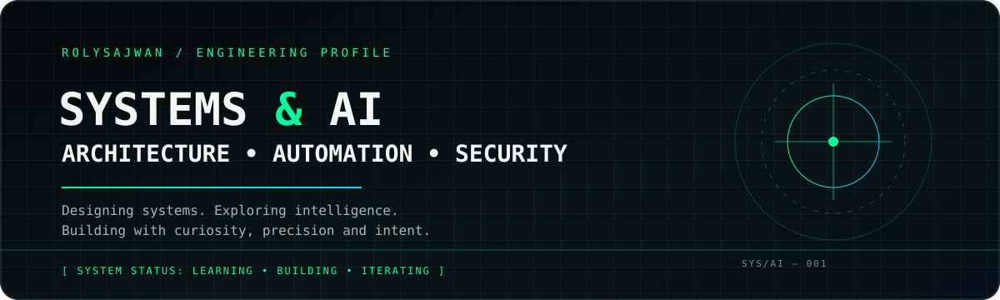

 

<strong>Systems thinking.</strong> &nbsp; <strong>Applied AI.</strong> &nbsp; <strong>Security-minded engineering.</strong>

<a href="#-current-focus">Current focus</a> &nbsp;•&nbsp; <a href="#-technology-stack">Technology stack</a> &nbsp;•&nbsp; <a href="#-github-analytics">GitHub analytics</a> &nbsp;•&nbsp; <a href="#-connect">Connect</a>

---

## `01 / PROFILE`

> I’m interested in how systems fit together — from developer tools and cloud infrastructure to automation, AI and security.

I use this space to explore technologies, build practical projects, document what I learn, and improve my engineering workflow. I value **clear architecture, useful automation, thoughtful security and continuous learning**.

<table>
<tr>
<td width="50%" valign="top">

### ◈ Engineering mindset
- Break complex problems into smaller systems
- Prefer readable, maintainable solutions
- Automate repetitive work where it makes sense
- Treat security and reliability as design concerns

</td>
<td width="50%" valign="top">

### ◈ Areas of interest
- Artificial intelligence and intelligent tools
- Linux and command-line workflows
- Cloud-native systems and containers
- Cybersecurity fundamentals and secure design

</td>
</tr>
</table>

## `02 / CURRENT FOCUS`

<table>
<tr>
<td width="33%" valign="top">

### `01` — AI
Explore AI systems, practical automation and tools that make intelligent workflows useful.

</td>
<td width="33%" valign="top">

### `02` — INFRASTRUCTURE
Learn how Linux, containers, cloud services and orchestration work together in real deployments.

</td>
<td width="33%" valign="top">

### `03` — SECURITY
Build a security-first mindset through fundamentals, defensive practices and responsible experimentation.

</td>
</tr>
</table>

## `03 / TECHNOLOGY STACK`

### Core tools

### Development

### Infrastructure & cloud

Tools and areas of interest reflect the profile's stated focus; proficiency varies by technology.

## `04 / GITHUB ANALYTICS`

&nbsp;

<em>Analytics are provided by third-party services and may occasionally be unavailable or delayed.</em>

## `05 / BUILD PRINCIPLES`

| `01` CLARITY | `02` RELIABILITY | `03` RESPONSIBILITY |
|:---:|:---:|:---:|
| Make complexity understandable. | Prefer systems that are testable and maintainable. | Learn and experiment ethically. |

## `06 / CONNECT`

  

