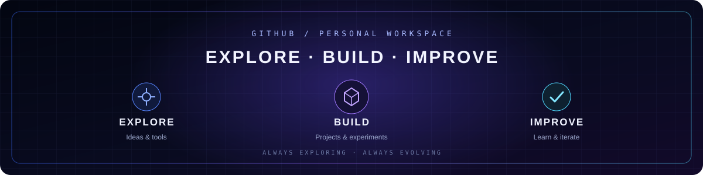

<picture>
  <source media="(prefers-reduced-motion: reduce)" srcset="./assets/hero-static.svg">
  
</picture>Technology · Creativity · Digital Development

 "// 01 — ABOUT ME"

Hi, I'm Rahul Sajwan.

I'm interested in technology, software development, and creating digital experiences that bring ideas to life.

My interests span web development, artificial intelligence, automation, modern software tools, and digital design. I enjoy exploring new technologies, working on practical ideas, and finding ways to combine functionality with a clean, thoughtful user experience.

I believe good projects come from a balance of clear thinking, attention to detail, and a willingness to explore better approaches.

This GitHub profile showcases my projects, ideas, and work across technology and digital development.

"// 02 — AREAS OF INTEREST"

- Web Development — Websites, digital platforms, and modern web experiences.
- Artificial Intelligence — AI tools, generative technologies, and practical applications.
- Software & Technology — Exploring software, development tools, and emerging technologies.
- Automation — Finding practical ways to simplify workflows and improve efficiency.
- UI/UX & Digital Design — Creating clear, visually consistent, and user-friendly interfaces.
- Creative Projects — Combining technology, design, and ideas to build useful digital experiences.

"// 03 — TECHNOLOGY OBSERVATORY"

Different technologies, connected by ideas, creativity, and practical applications.

"// 04 — MY APPROACH"

I focus on practical ideas, thoughtful implementation, and continuous improvement. Whether working on a website or exploring a new tool, I value functionality, visual consistency, and the overall experience.

My goal is to create digital work that is useful, well-presented, and built with attention to detail.

"// 05 — PROJECTS & DEVELOPMENT"

I use GitHub to maintain my projects, organize code, and share my work.

One of my projects is DevGanga Amrit, a brand inspired by the spiritual heritage of Devprayag. The project brings together brand identity, website development, and a digital presence built around its cultural and spiritual concept.

I'm interested in building projects that connect technology with practical ideas and thoughtful design.

<a href="https://github.com/rolysajwan?tab=repositories">EXPLORE MY REPOSITORIES ↗</a>

"// 06 — CONNECT"

<a href="https://github.com/rolysajwan">GITHUB PROFILE ↗</a>

